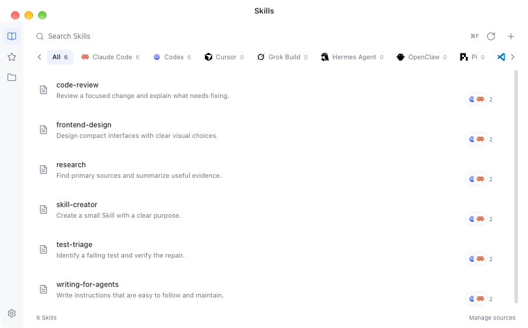

# SkillView

A compact macOS app for finding, reading and editing local Agent Skills. Original files remain in their own folders; Skill instructions and scripts are never executed.



The screenshot uses synthetic documents and isolated settings.

## Try the preview

Download the Apple Silicon ZIP from [GitHub Releases](https://github.com/sogud/skillview/releases). This is an experimental preview, ad-hoc signed and not notarized by Apple. macOS may block a downloaded app; see [Apple's app-opening guidance](https://support.apple.com/en-us/102445). Only open a build you trust. The project does not disable Gatekeeper or remove quarantine attributes.

The bundle declares macOS 13 or newer, but the minimum OS has not been accepted on a real macOS 13 device. Intel builds are not provided. See [release readiness](RELEASE_READINESS.md) for the remaining checks.

## Features

- Click Scan to read known global skill/plugin directories across 83 Agent definitions, plus folders you explicitly add. Home and connected drives are not searched. Startup opens the saved catalog without a background scan. Manual scanning shows folder counts and can be canceled; inaccessible paths and scan limits are reported.
- Agent tabs wrap into rows and show installed local applications or executables by default. Configuration folders alone do not count as an installation.
- One list entry per Skill name, with overlapping platform logos and a platform count. Different contents remain available as versions and independent copies in the reader.
- A compact file tree beside the document shows `SKILL.md`, references, scripts and assets. Click a file to read or edit it; folders expand with the mouse or arrow keys. Search, revision checks, collision-safe creation, resource import and rename, macOS Trash and persisted restore records remain available.
- System/light/dark appearance and a configurable theme color. English and Simplified Chinese interface, following the system language by default. Translation services include free Google and Youdao web translation, self-hosted LibreTranslate and OpenAI-compatible AI. See [translation setup](docs/translation.md).
- AI uses the official OpenAI Go SDK with a configurable compatible endpoint, including local models. Keys stay in macOS Keychain. Translation only runs after a click and does not modify the original file.
- Translation shows completed sections, elapsed time, a completion label and clear failure/retry controls. Cancel an in-flight translation, copy it with its target-language label or export it to a separate new file. A user-requested connection test sends only a fixed sample and bypasses cached results.
- External additions appear after a manual scan. SQLite stores disposable catalog and translation caches; originals and editor drafts remain authoritative.
- From alpha.2, check GitHub Releases at launch and every six hours. A theme-colored titlebar icon opens release notes, signed download progress and restart controls. Unsaved edits use the existing save/discard prompt. Settings and the app menu also offer **Check for updates**.

Automatic and linked sources are read-only. Choose an original folder in **Settings → Folders → Allow editing** to enable writes. A grouped entry does not synchronize or delete every copy: editing and Trash apply only to the selected original.

Selecting a link's containing folder for editing also allows moving that final link entry to Trash. Its target stays in place. Parent-directory links require selecting the actual containing directory; replaced links are refused. Resource links can be removed without reading their targets.

## Run and build

Requires an Apple Silicon Mac, Node/npm and Xcode Command Line Tools (`xcode-select --install`). CI uses Node 24.16.0 and Go 1.27.2. The bootstrap installs the pinned Go 1.27.2 when needed and checks its official SHA-256. Wails v3.0.0-beta.27 and dependency versions are pinned.

```sh
git clone https://github.com/sogud/skillview.git
cd skillview
bash script/build_and_run.sh
# Build without launching, or create ZIP/DMG packages:
bash script/build.sh
bash script/package.sh
```

Tools, caches and acceptance fixtures stay under `.artifacts`; builds and packages stay under `bin`. No development server is needed to launch the production `.app`. Save drafts before rebuilding. The bootstrap downloads Go only when missing and checks its official SHA-256.

For an isolated acceptance build, set `SKILLVIEW_APP_BUNDLE` to a new absolute `.app` path under `.artifacts`. `script/package.sh` uses the same bundle path; `SKILLVIEW_RELEASE_DIR` selects a separate package directory.

The [macOS preview workflow](.github/workflows/preview.yml) reuses these build/package scripts on pushes, pull requests and manual dispatch. It tests file operations and translation, checks known runtime dependency vulnerabilities, and uploads packages with their source commit and build environment. Downloaded package sets can be checked from their own directory with `shasum -a 256 -c <package>.sha256`.

Focused checks:

```sh
source script/toolchain.sh
ensure_go
go test -race ./internal/library ./internal/translation ./internal/cache ./internal/watch ./internal/updates
npm --prefix frontend ci
npm --prefix frontend run build
node --test frontend/src/skill-groups.test.mjs
```

Settings, recovery copies, derived caches and restore receipts live in `~/Library/Application Support/SkillView`. Clear cache does not remove originals, preferences, recovery copies or keys.

Translation sends the selected document to the provider you choose. It runs only after a click. The optional no-key Google endpoint is unofficial and may be unavailable. API keys are kept in macOS Keychain; the configured provider may charge for requests. There is no Skill execution, cloud synchronization or telemetry.

Update checks send the app version and platform to public GitHub release endpoints; they do not send Skill content or local paths. Downloads require a click. Alpha.1 needs one manual upgrade to a build with the updater. In-app installation requires a writable app bundle on the same volume as the macOS temporary directory; otherwise use the GitHub download link. See [updates and publishing](docs/updates.md).

See [implementation](docs/architecture.md), [source research](docs/sources.md), [verification](docs/verification.md), [open-source review](docs/open-source-review.md) and [contributing](CONTRIBUTING.md). Report vulnerabilities through the [security policy](SECURITY.md).

## License and credits

SkillView source is [MIT licensed](LICENSE). Dependencies and reused assets keep their own licenses, collected in [third-party notices](THIRD_PARTY_NOTICES.md) and included in the app bundle. The two unmodified HashiCorp libraries use MPL-2.0; their notices link to the exact upstream sources. Agent names and logos identify compatible tools and do not imply affiliation. [Magpie](https://github.com/yetone/magpie) inspired the compact interface; [Vercel Skills](https://github.com/vercel-labs/skills) supplied the Agent location registry. See [source research](docs/sources.md) for attribution.
